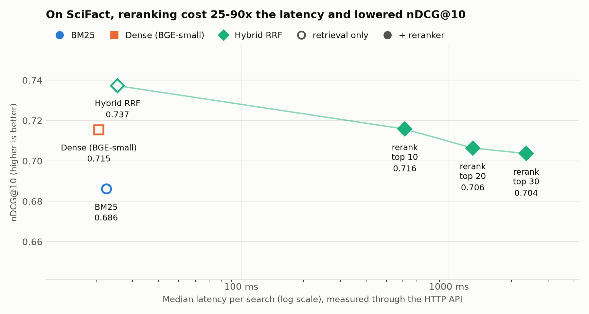
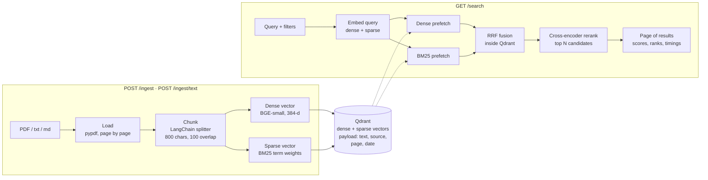
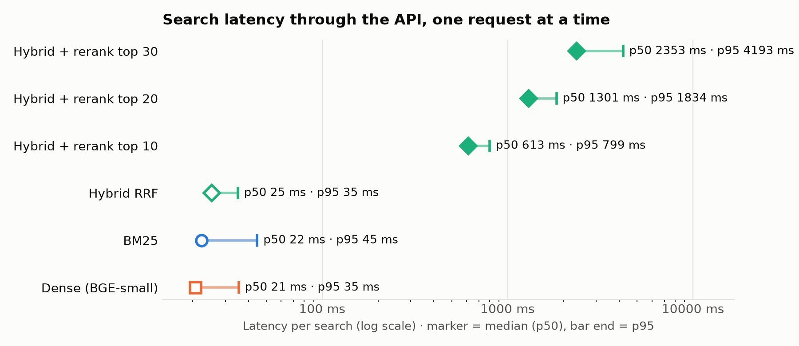

# Semantic Search API

A production-style semantic search REST API. Upload PDFs, text or Markdown; search them by meaning **and** exact words (hybrid dense + BM25 retrieval in **Qdrant**), with a **cross-encoder reranker** on top. Built with **FastAPI**, runs with one `docker compose up`, and benchmarked for quality and latency through the API on a human-labelled dataset.


<picture>
  <source media="(prefers-color-scheme: dark)" srcset="docs/tradeoff_dark.png">
  
</picture>

## Features

- **Hybrid retrieval inside Qdrant**: every chunk stores a dense vector (BGE-small, meaning) and a sparse BM25 vector (exact words, IDF computed by Qdrant); both searches run in one query and are merged with Reciprocal Rank Fusion. **nDCG@10 0.737**, significantly better than dense alone (0.715, p = 0.03) and BM25 alone (0.686, p < 0.001), at **25 ms median latency**
- **Cross-encoder reranker** (ms-marco-MiniLM-L-6-v2) for the top 20 candidates, per request (`rerank=true`, `candidates=…`). **Off by default, a decision taken from the benchmark**: on SciFact it lowered quality and cost 25–90× the latency ([results](#results))
- **Ingest** PDF, `.txt` and `.md` files (`POST /ingest`) or JSON batches of text (`POST /ingest/text`); PDFs keep **page numbers**; re-uploading a file **replaces** it (deterministic IDs, no duplicates)
- **Metadata filters** (one or several sources, document date range) applied inside the vector search, and **consistent pagination** (pages never overlap or skip, tested)
- **Production basics**: Pydantic settings from environment variables, **JSON logs** with a request ID per request (returned as `X-Request-ID`) and per-stage timings, `/health` that checks Qdrant, clear error codes (400, 404, 413, 415, 422, 503)
- **Async FastAPI**: model inference runs in a worker thread, so the event loop keeps serving requests
- **Docker Compose**: Qdrant + API with health checks and a persistent volume; multi-stage image with the three models baked in (starts offline), non-root user
- **33 tests in under a second**, no Docker, network or model download needed (in-memory Qdrant + a deterministic fake encoder)

## How it works



1. **Load** (`loaders.py`): PDFs page by page with `pypdf`, text files whole, all as LangChain `Document`s; source file name and page number travel with the text.
2. **Chunk**: LangChain's `RecursiveCharacterTextSplitter`, 800 characters with 100 overlap, cutting at paragraphs, then lines, then sentences.
3. **Embed** (`encoders.py`, through `fastembed` on ONNX Runtime, no PyTorch): a 384-dimensional dense vector from `BAAI/bge-small-en-v1.5` (queries get BGE's instruction prefix) and a sparse BM25 vector (`Qdrant/bm25`).
4. **Store** (`store.py`): one Qdrant point per chunk with both named vectors and a payload (`text`, `source`, `page`, `chunk_index`, `date`); point IDs are `uuid5(source, chunk index)`, so re-ingesting overwrites. Payload indexes make the filters fast.
5. **Search** (`service.py`): the query is embedded both ways; Qdrant runs a dense and a BM25 prefetch (with the filters) and fuses them with RRF; if reranking is requested, the top N (default 20) are rescored by the cross-encoder, which reads query and passage together; then the requested page is returned with the scores, the rank before reranking and a timing breakdown.

## Results

Measured through the HTTP API with the Docker Compose stack: **BEIR SciFact**, 5,183 scientific abstracts and **300 test queries with human relevance labels** (the dataset from my [retrieval-eval-bench](https://github.com/abhisheklakhani-it/retrieval-eval-bench)). Chunk size 2,000 characters, so each abstract stays whole, as in that benchmark. Apple M2, Docker Desktop (8 vCPUs), 4 model threads, on AC power. Reproduce with `scripts/benchmark.py`.

| Setup | Recall@10 | MRR@10 | **nDCG@10** | p50 latency | p95 latency |
|:--|--:|--:|--:|--:|--:|
| BM25 (sparse vectors in Qdrant) | 0.812 | 0.653 | 0.686 | 22 ms | 45 ms |
| Dense (BGE-small) | 0.838 | 0.684 | 0.715 | 21 ms | 35 ms |
| **Hybrid RRF** | **0.860** | **0.705** | **0.737** | 25 ms | 35 ms |
| Hybrid + rerank top 10 | 0.860 | 0.678 | 0.716 | 613 ms | 799 ms |
| Hybrid + rerank top 20 | 0.838 | 0.673 | 0.706 | 1,302 ms | 1,834 ms |
| Hybrid + rerank top 30 | 0.829 | 0.672 | 0.704 | 2,353 ms | 4,193 ms |

<picture>
  <source media="(prefers-color-scheme: dark)" srcset="docs/latency_dark.png">
  
</picture>

**Findings**

1. **Hybrid search is the best setup here**: +0.022 nDCG@10 over dense (p = 0.03) and +0.051 over BM25 (p < 0.001), for 4 ms more than dense alone. It matches the offline benchmark (0.728 there), which suggests the Qdrant pipeline, the BM25 vectors and the metrics are correct.
2. **The reranker made results worse on this dataset**: −0.021 to −0.034 nDCG@10, all significant (paired randomization test, p ≤ 0.043), while costing **25–90×** the latency. **It is not a bug**: reranking BM25's top 100 with the same cross-encoder gives **0.695** through this API, close to the **0.688** published for that setting in the [BEIR paper](https://arxiv.org/abs/2104.08663) (`scripts/rerank_sanity.py`). The reranker works; it is weaker than the hybrid on this data. A likely reason: it was trained only on MS MARCO web-search questions, while SciFact's queries are scientific claims. Reranking more candidates also did not help: top 20 vs top 10 −0.009 (p = 0.13).
3. **The reranker dominates latency**: embedding the query takes ~15 ms and the Qdrant search ~9 ms, but each reranked abstract costs ~60 ms on CPU, because a cross-encoder runs the full transformer on every (query, passage) pair at search time. Under load (4 requests at a time), hybrid search served **40 queries/s** (p95 180 ms) and hybrid + rerank top 20 only **0.55 queries/s**.

**What this changed in the API**: reranking was on by default; after this benchmark it is **off by default** (hybrid search, 25 ms). It stays available per request (`rerank=true`, `candidates=…`) or as the default (`SEMSEARCH_RERANK_BY_DEFAULT=true`), because on web-style questions like MS MARCO, the data it was trained on, cross-encoders usually help. The right choice depends on the data, so **measure on your own labelled queries** before paying the latency.

Full tables, per-query scores and significance tests: [`results/`](results/results.md).

### Engineering findings along the way

- **Out of memory → batch size 1.** fastembed embeds 256 texts per call by default; attention memory grows with batch × length², and ingesting long abstracts ran a 4 GB container out of memory. Measuring batch sizes on the M2 showed **batch 1 was also the fastest** (38 vs 17 chunks/s at batch 16): each text in a batch is padded to the longest one, and that padding is wasted work.
- **4 threads beat 8.** The M2 has 4 performance and 4 efficiency cores; with 8 threads the fast cores wait for the slow ones. 4 threads embedded 2× faster (`SEMSEARCH_MODEL_THREADS`).
- **Offline BM25 bug.** The container could not load the BM25 model offline: fastembed declares its model file as `mock.file`, which never exists, so the cache check always fails. Worked around by passing the cached snapshot folder directly (`encoders.py`).
- **Dropped `langchain-community`.** It was sunset during the project; its PDF loader was a thin wrapper over `pypdf`, so the loaders are now ~15 lines here. **Image 609 → 549 MB (−10%)**, same LangChain `Document`s and splitter.

## Quick start

```bash
git clone https://github.com/abhisheklakhani-it/semantic-search-api.git
cd semantic-search-api
docker compose up -d --build          # Qdrant + API; the models are baked into the image
# port 8000 taken? API_PORT=8080 docker compose up -d --build

curl localhost:8000/health
curl -F "file=@examples/iso26262.pdf" -F date=2026-09-28 localhost:8000/ingest
curl -F "file=@examples/adas_sensors.txt" localhost:8000/ingest
curl "localhost:8000/search?q=which+sensor+works+in+fog&k=3"
curl "localhost:8000/search?q=which+sensor+works+in+fog&k=3&rerank=true"   # with the cross-encoder
```

Interactive docs at <http://localhost:8000/docs>, Qdrant's dashboard at <http://localhost:6333/dashboard>.

| Method | Path | What it does |
|:--|:--|:--|
| `GET` | `/health` | Qdrant reachable? Returns the collection and chunk count (503 if Qdrant is down) |
| `POST` | `/ingest` | Upload a `.pdf`, `.txt` or `.md` file (form field `file`, optional `date`); replaces an earlier upload with the same name |
| `POST` | `/ingest/text` | JSON batch: `{"documents": [{"source", "text", "date"?}]}`, up to 1,000 per request |
| `GET` | `/search` | `q`, `k` (1–50), `offset`, `mode` (`hybrid`, `dense`, `bm25`), `rerank`, `candidates`, `source` (repeatable), `date_from`, `date_to` |
| `GET` | `/sources` | Sources and their chunk counts |
| `DELETE` | `/sources/{source}` | Delete a source and all its chunks |

Example response of `GET /search?q=ASIL+D+examples&k=1&rerank=true` (shortened):

```json
{
  "query": "ASIL D examples",
  "mode": "hybrid",
  "reranked": true,
  "candidates": 20,
  "k": 1,
  "offset": 0,
  "results": [
    {
      "rank": 1,
      "score": 4.2951,
      "retrieval_rank": 1,
      "retrieval_score": 0.8333,
      "text": "Automotive Safety Integrity Levels There are four ASILs, from ASIL A (lowest) to ASIL D (highest). ... An airbag or a braking system is typically ASIL D ...",
      "source": "iso26262.pdf",
      "page": 2,
      "chunk_index": 1,
      "date": "2026-09-28"
    }
  ],
  "timings": {"embed_ms": 5.7, "retrieve_ms": 18.6, "rerank_ms": 37.7, "total_ms": 62.0}
}
```

Every request is logged as one JSON line, for example:

```json
{"time": "2026-09-30T00:57:10.037+00:00", "level": "INFO", "logger": "semsearch", "message": "search", "request_id": "9ec17395f4ea49b4", "query_chars": 12, "mode": "hybrid", "rerank": true, "k": 2, "offset": 0, "filtered": true, "hits": 2, "embed_ms": 5.7, "retrieve_ms": 18.6, "rerank_ms": 37.7, "total_ms": 62.0}
```

Settings are environment variables with the prefix `SEMSEARCH_` (see [`config.py`](src/semsearch/config.py) and [`.env.example`](.env.example)), e.g. `SEMSEARCH_CHUNK_SIZE`, `SEMSEARCH_RERANK_CANDIDATES`, `SEMSEARCH_MODEL_THREADS`.

## Tests

```bash
python3 -m venv .venv && source .venv/bin/activate
pip install -r requirements-dev.txt
pytest -v        # 33 tests in under a second
```

The tests use Qdrant's in-memory mode and a deterministic fake encoder (hashed bag-of-words vectors), injected through the app factory, so the whole API runs in-process through FastAPI's `TestClient`. They cover loading and chunking (including real PDFs built by a tiny PDF writer in `tests/pdf_utils.py`), ingest errors (400, 413, 415, 422), re-ingest without duplicates, every search mode, the reranker deciding the final order, source and date filters, **pages that neither overlap nor skip results** across the reranked/not-reranked border, request IDs, JSON logs and settings.

## Project structure

```
src/semsearch/
  api.py            FastAPI app: lifespan, logging middleware, endpoints
  service.py        embed (in a worker thread) -> retrieve -> rerank -> page
  store.py          Qdrant: collection, idempotent upsert, delete, hybrid search, filters
  encoders.py       dense (BGE-small), sparse (BM25) and reranker models via fastembed
  loaders.py        PDF / text -> LangChain Documents -> chunks with page numbers
  schemas.py        Pydantic request and response models
  config.py         settings from environment variables (SEMSEARCH_*)
  logging_setup.py  JSON log formatter
scripts/
  benchmark.py      quality + latency through the HTTP API (SciFact)
  plot_results.py   README charts (light and dark)
examples/           sample documents (automotive topics)
results/            benchmark tables (CSV and Markdown) and run settings
tests/              pytest suite (in-memory Qdrant, fake encoder)
```

## Limitations

- **One evaluation dataset.** SciFact is scientific English with claim-style queries; the reranker result may well flip on web-style questions. Evaluate on your own data.
- **CPU latency on a laptop**, inside Docker Desktop's VM. A Linux server (no VM) or a GPU would be much faster for the reranker; the relative costs would stay similar.
- **No authentication or rate limiting**; put the API behind a gateway before exposing it.
- **Ingestion is synchronous**: a large PDF blocks its request while it is embedded (~10 abstracts/s on this CPU). A background job queue would be the next step.
- **Scanned PDFs** (no text layer) are rejected with 422; OCR is implemented in my [rag-docqa](https://github.com/abhisheklakhani-it/rag-docqa) project.

## What I learned

- **Benchmark before adding "best practices".** A cross-encoder reranker is standard advice for RAG, but on this data it cost 25–90× the latency and lowered quality. Without the labelled benchmark I would have shipped it on by default.
- **Measure performance, don't assume it.** Batch size 1 and 4 threads were the fastest settings, the opposite of my first guesses; and measuring on battery in Low Power Mode made the same work up to 3× slower.
- **Read the library source when something fails.** The offline BM25 crash and the out-of-memory ingest were both explained by a few lines inside fastembed.
